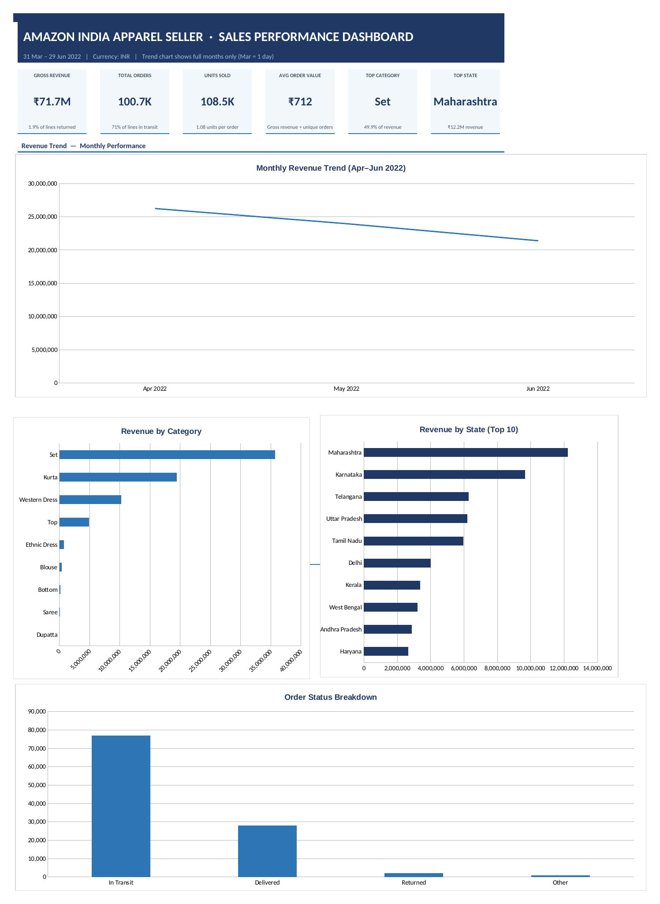

# Amazon India Apparel Sales Dashboard (Excel)

An Excel dashboard analysing ~108,000 order lines from an apparel seller on Amazon India, covering 31 March to 29 June 2022. It answers three questions: which products drive revenue, where customers are, and how sales moved month to month.

## Key Findings

- **Two categories carry the business.** Sets (49.9%) and Kurtas (27.1%) bring in 77% of the ₹71.7M gross revenue. The bottom five categories together are under 2%.
- **Sales are concentrated in a few states.** Maharashtra (₹12.2M) and Karnataka (₹9.6M) alone account for about 31% of revenue.
- **Revenue declined each full month.** Daily revenue fell from about ₹874K in April to ₹773K in May and ₹738K in June, roughly a 16% drop over the quarter.
- **Most orders are single items.** 100,727 orders contained 108,483 units, about 1.08 units per order, with an average order value of ₹712.
- **Returns are low, but many orders were still open.** Only 1.9% of order lines were returned, but 71% were still in transit when the data was pulled, so the final return rate is likely higher.

## Data

- **Source:** Kaggle "Amazon Sale Report" (Amazon India e-commerce sales, 2022).
- **Scope:** Cancelled orders excluded. Revenue is the gross value of all remaining orders, including returns.
- **Note on March:** the dataset only contains one day of March (31 March), so the monthly trend chart shows April–June only. March is still included in the totals.

## Cleaning Steps

- Filled 26 blank `State` values with "Unknown"
- Grouped detailed order statuses into four buckets: In Transit, Delivered, Returned, Other
- Added a `Month` column from the order date
- Kept 7,344 repeated Order IDs, since these are multi-item orders (one row per product)
- Added an `Is_First_Line` flag so the dashboard counts **unique orders** (100,727) rather than order lines (108,071)

## How It's Built

| Sheet | What it does |
|---|---|
| **Dashboard** | KPI cards and four charts |
| **Summary Tables** | Revenue, orders and units by month, category, state and status, plus KPI calculations |
| **Category x Month** | Revenue matrix by category and month, with average revenue per line |
| **Clean Data** | The cleaned dataset as an Excel Table, plus cleaning notes |

All numbers are live formulas (`SUMIFS`, `COUNTIFS`, `AVERAGEIF`, `IF`) built on the Excel Table, so the dashboard updates if the data changes. The summary tables are formula-based rather than native PivotTables, which keeps every calculation visible and easy to check. The category and state lists are fixed to the top items at the time of analysis.

## Skills Demonstrated

Data cleaning · Excel Tables and structured references · SUMIFS / COUNTIFS · KPI design · Dashboard layout · Data visualisation

## Files

- `Amazon_Dashboard_Final.xlsx`: full workbook (dashboard, summary tables and cleaned data)
- `dashboard-preview.png`: dashboard screenshot
